# ChatAgent Personal v1.0.0 — 프로젝트 최종 보고서

> **프로젝트 상태:** `PRODUCTION_ACTIVE_V1.0.0`  
> **제품:** ChatAgent Personal  
> **버전:** v1.0.0  
> **프로젝트 종료일:** 2026-09-27 KST  
> **운영 범위:** Single-owner macOS private production  
> **GitHub:** `exobiz7/chatagent-personal`  
> **Release SHA:** `d3279ee948f44f6b8bc66d446be52dc085983eee`  
> **Tag:** `v1.0.0`

---

## 0. Executive Summary

ChatAgent Personal 프로젝트는 **ChatGPT 채팅 자체를 사용자의 macOS 로컬 환경에서 안전하게 작업을 수행할 수 있는 실행 인터페이스로 확장**하는 것을 목표로 진행되었다.

최종 v1.0.0은 다음을 달성했다.

- ChatGPT Business와 로컬 macOS를 **OpenAI Secure MCP Tunnel**로 연결
- 파일 읽기·생성·안전한 교체·해시·비동기 복사/해시 지원
- owner-authorized host process 실행/관찰/중지 지원
- 프로젝트/태스크/체크포인트 기반 **Personal Memory** 제공
- `ASK → FULL_HOST → ASK` 권한 모델로 명시적 사용자 통제
- SHA-256 CAS 기반 **Safe Replace**
- copy/hash/process에 ownership·idempotency·recovery 적용
- 총 **33개 production MCP tool**
- standalone regression **34/34 PASS**
- release core smoke **PASS**
- Business production app smoke **PASS**
- 최종 P0/P1/P2 **0 / 0 / 0**
- GitHub merge/tag/release와 production runtime 전환 완료

개발 단계는 종료되었으며 이후는 **DevOps / 유지보수 / patch release** 단계다.

---

## 1. 프로젝트 목표

> **“ChatGPT 채팅창 자체가 사용자의 로컬 실행자(executor)가 되도록 한다.”**

단순한 원격 명령 실행기가 아니라 다음 조건을 만족하는 것이 목표였다.

1. 사용자가 명시적으로 권한을 위임한다.
2. 새 파일 생성과 기존 파일 변경을 구분한다.
3. 기존 파일 변경은 race/concurrency를 고려한다.
4. 장시간 작업은 durable/owned job으로 관리한다.
5. 재시도로 effect가 중복되지 않게 한다.
6. 대화 컨텍스트와 실행 권한을 분리한다.
7. Personal Memory가 host authority를 대신하지 못하게 한다.
8. 실제 ChatGPT Business production surface에서 동작시킨다.

---

## 2. 범위

| 영역 | 구현 |
|---|---|
| Local file read | list/stat/read/hash |
| File create | create-only UTF-8 write |
| Existing file modification | SHA-bound Safe Replace |
| Large-file hash | bounded async SHA-256 |
| Large-file copy | create-only async copy |
| Stage recovery | inspect / exact cleanup |
| Process execution | start/status/read/stop |
| Owner authority | ASK / FULL_HOST |
| Personal Memory | project/task/checkpoint/search |
| MCP exposure | 33 production tools |
| Secure connectivity | OpenAI Secure MCP Tunnel |
| Release engineering | CI, tag, GitHub Release |
| Production validation | Business app smoke + canary |

### v1.0.0에서 제외

- multi-user 권한 모델
- root/sudo elevation
- macOS TCC 우회
- public Marketplace 배포
- 범용 원격관리/RMM
- public SaaS
- notarized public macOS package
- arbitrary delete API
- multi-host orchestration

---

## 3. 최종 시스템 아키텍처

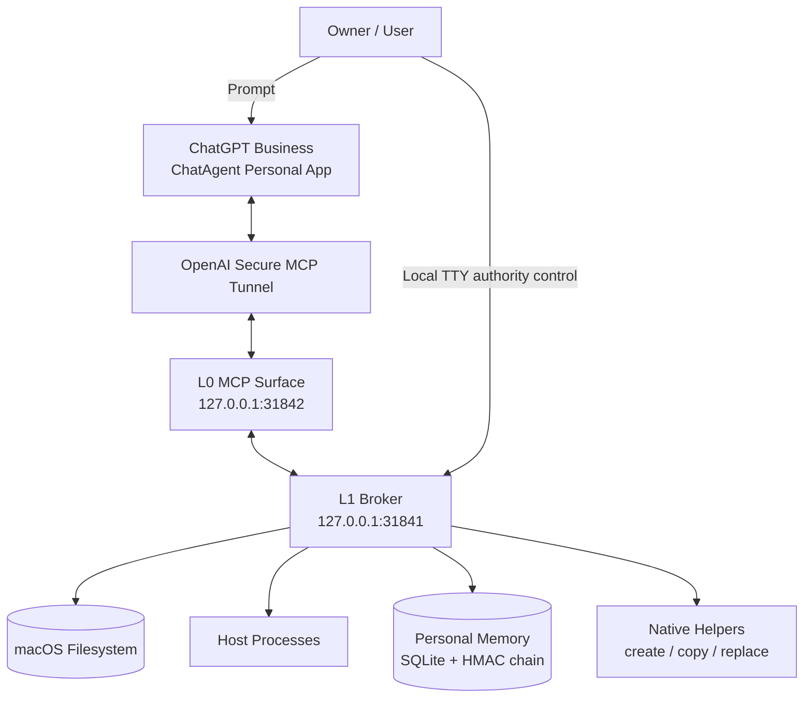

---

## 4. 권한 모델

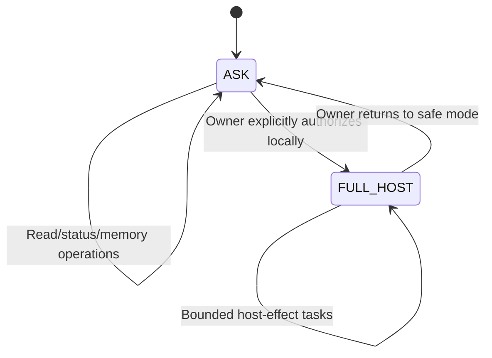

### ASK — 기본 production 상태

```text
paired=true
mode=ASK
realFilesystemAccess=false
realHostExec=false
```

### FULL_HOST — 임시 owner-authorized 상태

```text
paired=true
mode=FULL_HOST
realFilesystemAccess=true
realHostExec=true
```

FULL_HOST는 sudo/root/TCC bypass가 아니며 로그인 사용자의 일반 macOS 권한 범위를 넘지 않는다.

---

## 5. 핵심 설계 원칙

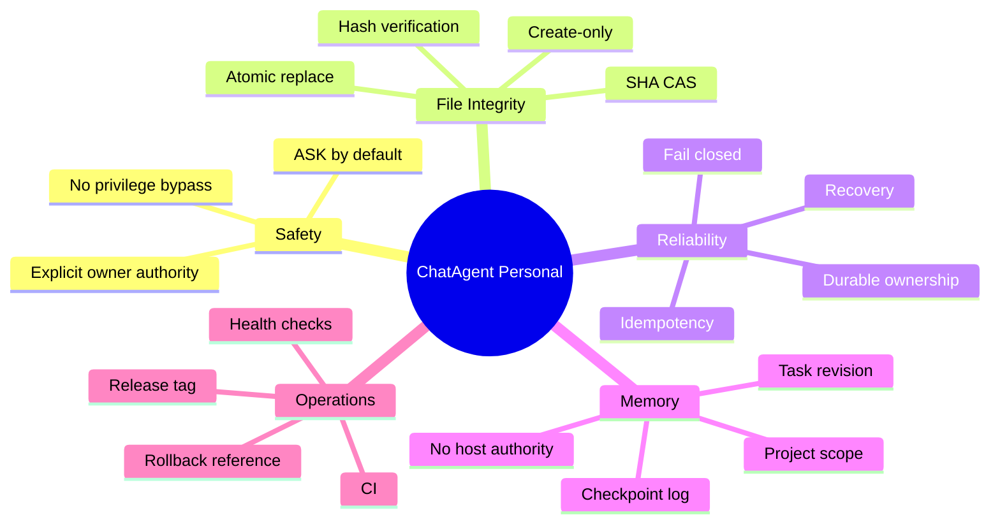

---

## 6. 33-tool Production Surface

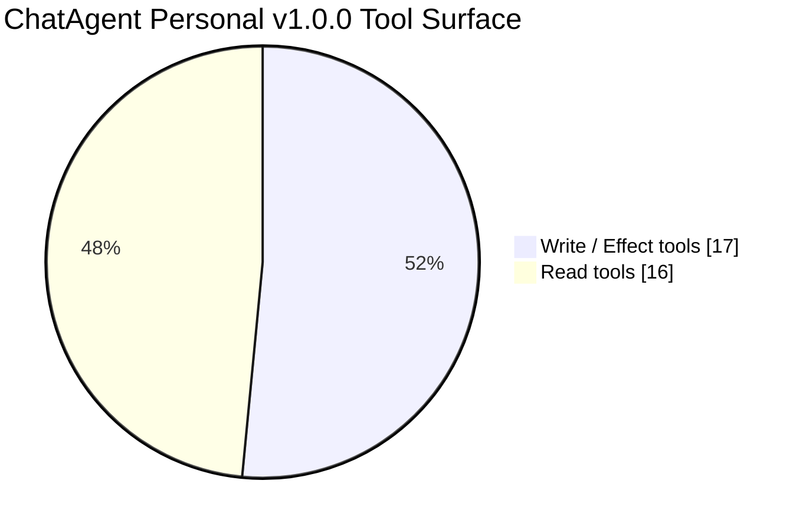

### Write / Effect — 17

| Tool | 역할 |
|---|---|
| `local_request_access` | L0 permission proposal |
| `personal_project_register` | project 등록 |
| `personal_task_start` | task 생성 |
| `personal_checkpoint_append` | checkpoint 추가 |
| `personal_task_complete` | task 완료 |
| `local_write` | create-only write |
| `local_create_file` | native create-only |
| `local_replace_file` | Safe Replace |
| `local_scratch_create` | owned scratch 생성 |
| `local_scratch_cleanup` | owned scratch 삭제 |
| `local_async_copy_start` | async copy 시작 |
| `local_async_copy_stop` | owned copy 중지 |
| `local_copy_stage_cleanup` | exact stage cleanup |
| `local_async_hash_start` | async hash 시작 |
| `local_async_hash_stop` | owned hash 중지 |
| `local_exec_start` | process 실행 |
| `local_process_stop` | owned process 중지 |

### Read — 16

| Tool | 역할 |
|---|---|
| `local_access_status` | owner/access 상태 |
| `local_check_access` | request 상태 확인 |
| `personal_task_get` | task 조회 |
| `personal_project_context` | project context |
| `personal_memory_search` | checkpoint 검색 |
| `local_list` | directory listing |
| `local_stat` | stat |
| `local_read` | bounded UTF-8 read |
| `local_hash` | SHA-256 + size |
| `local_async_copy_status` | copy status |
| `local_async_copy_read` | copy progress/result |
| `local_copy_stage_inspect` | stage inspect |
| `local_async_hash_status` | hash status |
| `local_async_hash_read` | hash result |
| `local_process_status` | process status |
| `local_process_read` | process output |

---

## 7. 파일 작업 모델

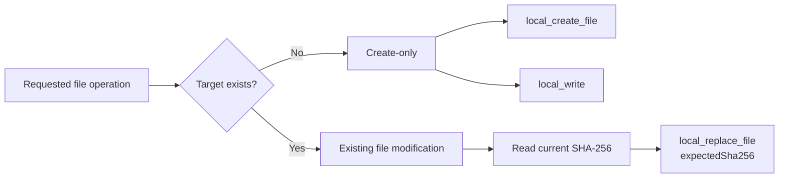

핵심:

> **새 파일 생성은 overwrite가 아니다. 기존 파일 수정은 별도의 명시적 Safe Replace이다.**

---

## 8. Safe Replace v2

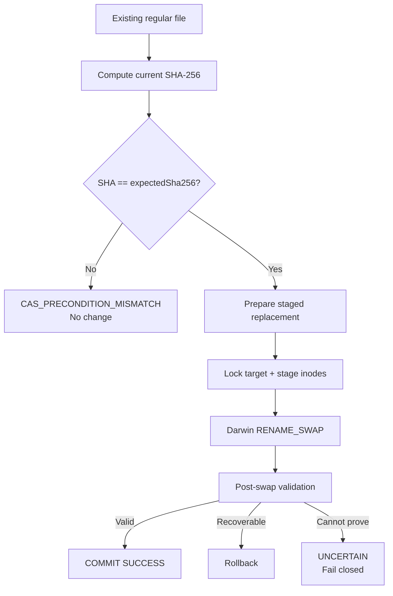

Commit mode:

```text
DIRFD_DUAL_EXLOCK_RENAME_SWAP
```

보장:

- exact expected SHA-256
- dual-inode `O_EXLOCK`
- Darwin atomic `RENAME_SWAP`
- post-swap validation
- safe rollback
- unsupported ACL/special flags refusal
- `UNCERTAIN` fail-closed

macOS advisory lock을 raw same-UID writer가 무시할 수 있으므로 universal exclusion을 주장하지 않는다. 성공을 증명할 수 없는 경우 성공 처리하지 않는다.

---

## 9. Async Copy

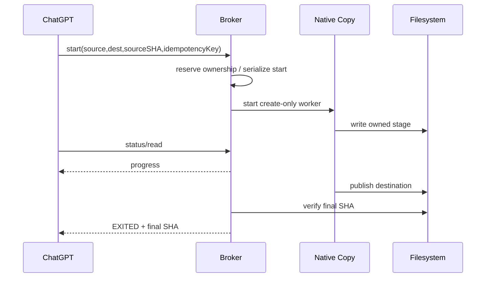

특징:

- exact source SHA
- create-only destination
- idempotency
- owned process
- concurrent first-start fencing
- durable recovery
- exact stage cleanup

---

## 10. Async Hash


읽기 전용이며 copy/replace/delete effect가 없다.

---

## 11. Host Process

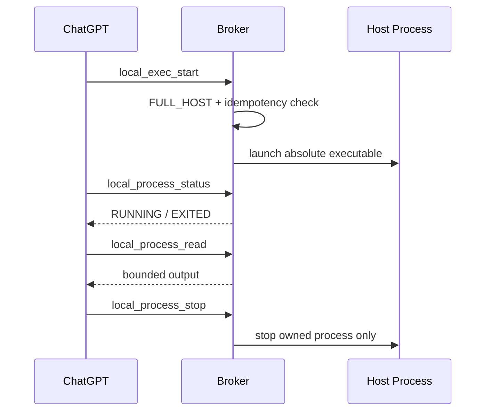

---

## 12. Personal Memory

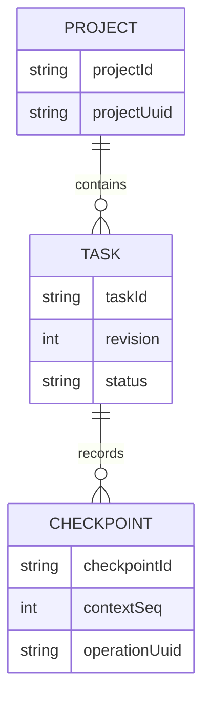

특징:

- project isolation
- revision/CAS
- operation UUID idempotency
- immutable completion
- durable SQLite
- HMAC event chain
- **memory != host authority**

---

## 13. 개발·검증 여정

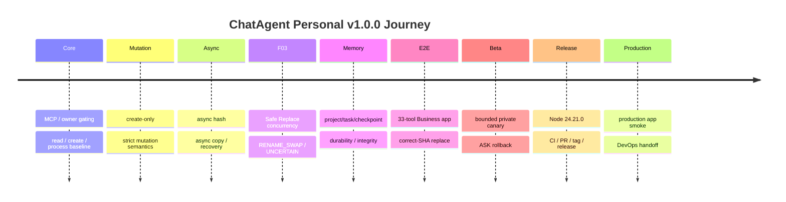

---

## 14. 주요 Finding Closure

### F03 — Safe Replace concurrency

초기 문제:

```text
final check → rename
```

사이에 race window 존재.

개선:

```text
SHA CAS
+ dual EXLOCK
+ atomic RENAME_SWAP
+ post validation
+ rollback
+ UNCERTAIN
```

최종:

```text
F03 = CLOSED
```

### CORE-COPY-01

문제: 동시 최초 `AsyncCopyJobs.start()`에서 ownership record 경쟁 가능.

개선:

- reservation/start/bind만 FIFO queue
- worker는 병렬 유지
- queue rejection poisoning 방지

최종:

```text
CORE-COPY-01 = CLOSED
```

---

## 15. 검증 체계

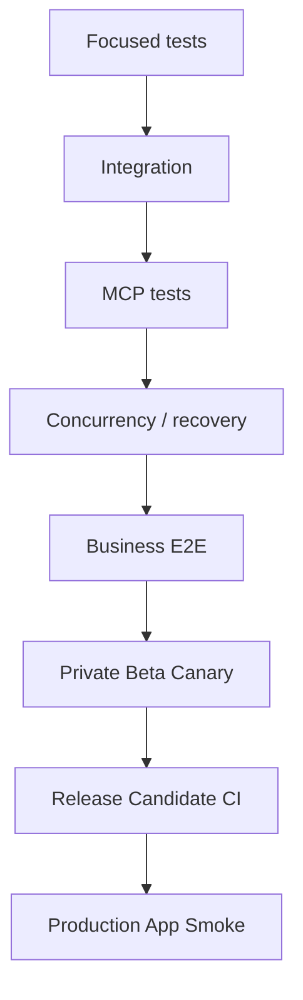

| 검증 | 결과 |
|---|---|
| Standalone suite | `34/34 PASS` |
| Release core smoke | `PASS` |
| Private beta canary | `PASS` |
| Business correct-SHA replace | `PASS` |
| Production app smoke | `PASS` |
| macOS RC CI | `PASS` |
| P0 / P1 / P2 | `0 / 0 / 0` |

---

## 16. Production Release

```text
Repository:
exobiz7/chatagent-personal

Main release SHA:
d3279ee948f44f6b8bc66d446be52dc085983eee

Tag:
v1.0.0

Release:
ChatAgent Personal v1.0.0
```

Runtime:

```text
Node v24.21.0
L1 127.0.0.1:31841
L0 127.0.0.1:31842
```

Operational root:

```text
~/ChatAgentPersonal
```

주요 명령:

```bash
cd ~/ChatAgentPersonal
./Start.command
./Stop.command
./Status.command
./EnableFullHost.command
./ReturnAsk.command
```

---

## 17. Production Tunnel

```text
Profile:
~/ChatAgentPersonal/tunnel-profile/chatagent-personal.yaml

Tunnel ID:
tunnel_6ab5204f29108191a16eee9b633f5a2a

Runtime key:
~/ChatAgentPersonal/secrets/tunnel-runtime-key
```

정상:

```text
health=200
ready=200
```

---

## 18. Tunnel 정리

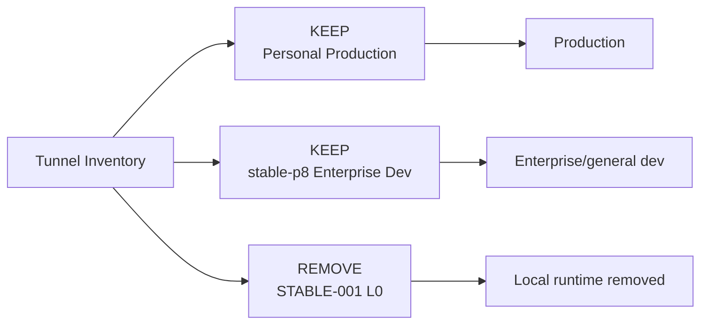

현재 의도적으로 유지:

1. ChatAgent Personal production
2. `stable-p8` enterprise/general development

제거:

- local STABLE-001 L0 semantic stack
- `:3113` listener
- old tmux L0 stack

소스 repo는 reference 용으로 보존했다.

---

## 19. 최종 운영 모델

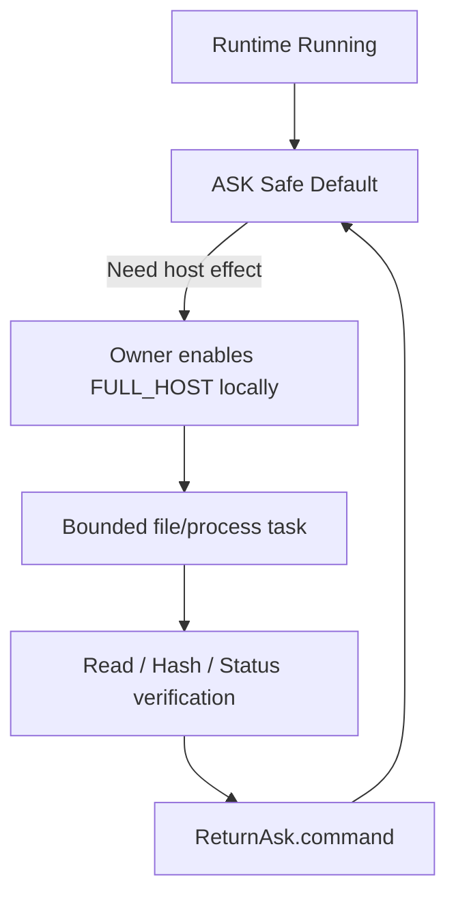

> **ASK by default → FULL_HOST only for an explicit task → verify → return to ASK**

---

## 20. Native Helper Provenance

| Helper | SHA-256 |
|---|---|
| `native-create-excl` | `5db079d0b132ac196cb49a74f7aef35db30d8ba91f63e59ff0526a0fc9ffb0c4` |
| `native-copy-create` | `9d77cd7ad5370afb09308a20c38d1d65dd23cfbe89dd1b031950a2327cfc3265` |
| `native-replace-cas` | `3c9b54143bda17f1e66126bd1d9c9ebc1350033019bbb21190d1876ca9258ab7` |

release rebuild와 active binary가 SHA-256 기준 일치했다.

---

## 21. 성공 지표

```text
Production tools          33
Standalone tests          34/34 PASS
Release core smoke        PASS
Production app smoke      PASS
P0/P1/P2                  0/0/0
Release state             PRODUCTION_ACTIVE_V1.0.0
```

---

## 22. 제품 경계

### 보장

- single-owner local execution
- bounded file/process operations
- explicit owner authority
- safe create/replace separation
- durable owned jobs
- durable Personal Memory
- Business production integration

### 비보장

- malicious same-UID process에 대한 universal exclusion
- multi-user RBAC
- public distribution security model
- fleet management
- unattended privileged automation
- public Marketplace compliance

---

## 23. 운영 인수인계

개발 단계 종료 후 DevOps 단계로 전환했다.

```text
~/ChatAgentPersonal/ops/CHATAGENT_PERSONAL_DEVOPS_HANDOFF_20260927.md
```

향후 핵심 과제:

- reboot/startup behavior
- optional LaunchAgent/autostart
- log rotation
- periodic health check
- Memory backup/restore
- broker-state recovery
- credential rotation
- tunnel-client update policy
- stable-p8 normalization
- stale remote tunnel cleanup
- v1.0.x patch governance

---

## 24. 최종 상태

```text
Product:             ChatAgent Personal
Version:             v1.0.0
Status:              PRODUCTION_ACTIVE_V1.0.0
Production app:      ChatAgent Personal
Tool count:          33
Runtime:             Node v24.21.0
Default authority:   ASK
Production root:     ~/ChatAgentPersonal
GitHub:              merged / tagged / released
Validation:          PASS
Development phase:   CLOSED
```

---

## 25. 결론

ChatAgent Personal v1.0.0은 단순한 “로컬 명령 실행 MCP”가 아니다.

핵심 성과는 세 가지다.

1. **실행 가능성** — ChatGPT가 실제 macOS 파일·프로세스·메모리를 다룬다.
2. **통제 가능성** — 권한은 사용자가 로컬에서 명시적으로 부여하고 회수한다.
3. **검증 가능성** — 변경과 장기 작업이 hash·revision·ownership·idempotency·recovery로 검증된다.

> **ChatAgent Personal은 ChatGPT를 사용자의 명시적 권한 하에서 작동하는 안전하고 검증 가능한 macOS 로컬 실행자로 확장한 single-owner private production MCP 시스템이다.**