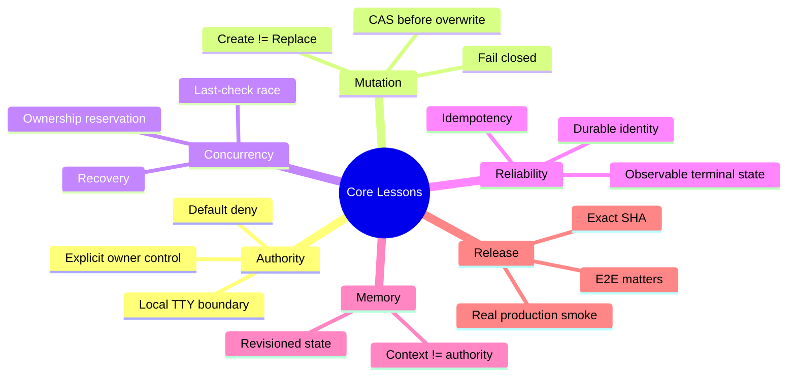
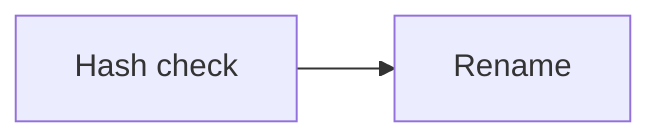
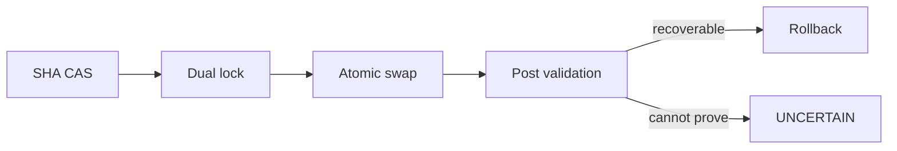
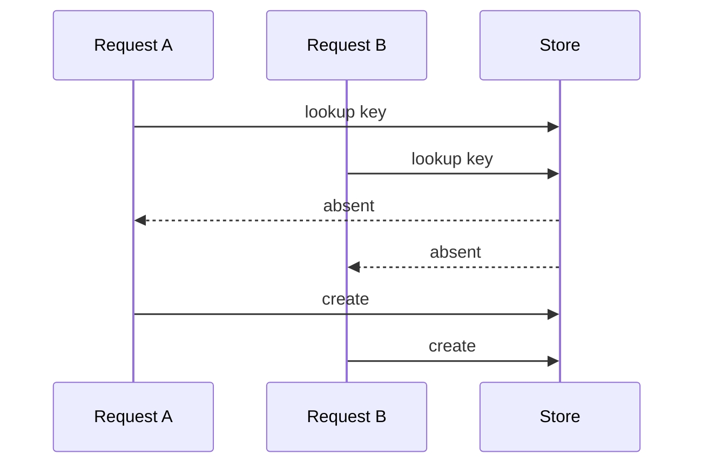
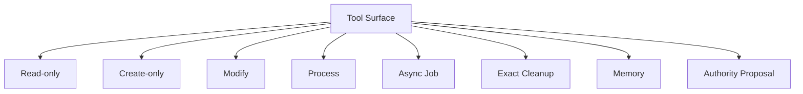
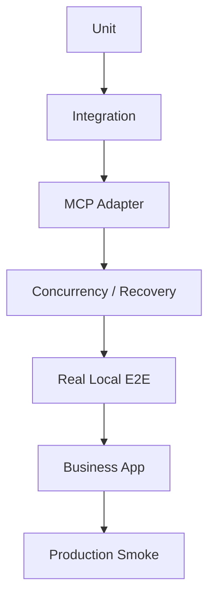
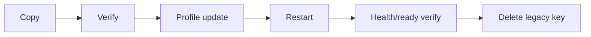
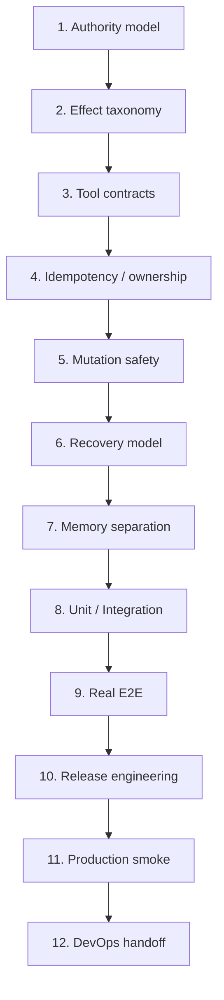
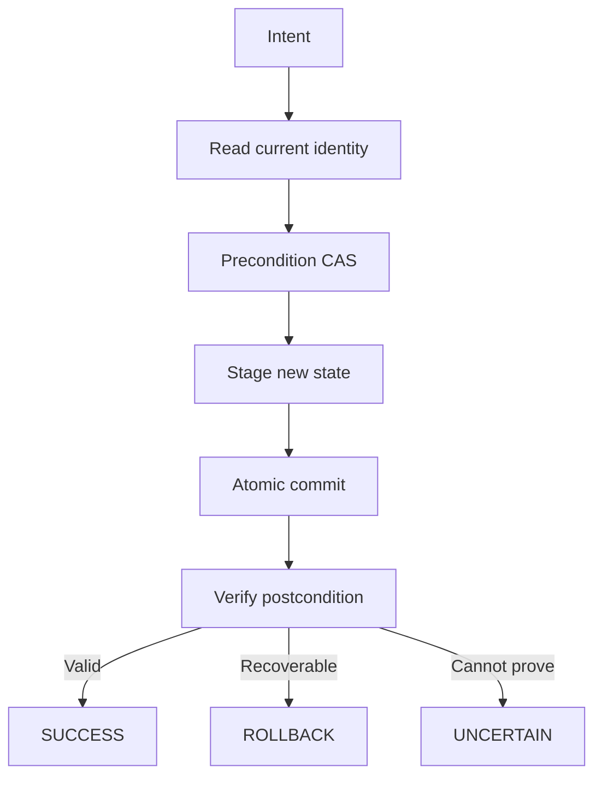
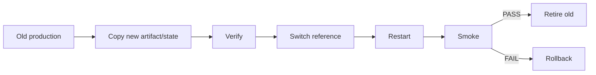

# ChatAgent Personal v1.0.0 — 프로젝트 회고 및 재사용 가능한 교훈

> **문서 목적:** 프로젝트 경험을 재사용 가능한 기술·제품·운영 지식으로 전환  
> **프로젝트:** ChatAgent Personal  
> **Version:** v1.0.0  
> **Status:** `PRODUCTION_ACTIVE_V1.0.0`  
> **Date:** 2026-09-27 KST

---

## 0. 이 문서를 남기는 이유

프로젝트가 성공적으로 끝나도 코드와 테스트만 남기면 다음 프로젝트에서 같은 판단과 시행착오를 다시 반복하게 된다.

이 문서는 ChatAgent Personal의 경험을 다음 유형의 프로젝트에도 재사용할 수 있도록 정리한 **지식 자산**이다.

- MCP application
- local AI agent
- autonomous executor
- coding agent
- personal automation
- desktop agent
- local-first AI system
- file/process orchestration
- secure tool-calling architecture
- long-running agent job system

핵심은 “무엇을 만들었는가”보다:

> **어떤 문제를 어떤 원칙으로 풀었고, 무엇이 위험했으며, 다음에는 어떤 순서로 접근하면 더 빠르고 안전한가**

를 남기는 것이다.

---

## 1. 가장 큰 교훈



---

## 2. 교훈 1 — Capability와 Authority를 분리하라

가장 흔한 잘못된 사고는 다음과 같다.

```text
도구가 연결돼 있다
→ 기술적으로 실행 가능하다
→ 실행해도 된다
```

안전한 구조는:

```text
사용자 의도
→ 현재 authority state
→ operation contract
→ execution
```

이어야 한다.

ChatAgent Personal은 이를:

```text
ASK
FULL_HOST
```

로 분리했다.

### 재사용 원칙

> **기술적으로 가능한 권한과 현재 위임받은 권한을 별도의 상태로 모델링하라.**

이는 email send, cloud deploy, DB mutation, payment, browser automation, code execution에도 그대로 적용된다.

---

## 3. 교훈 2 — Create와 Replace를 하나의 write로 뭉개지 않는다

나쁜 형태:

```text
write(path, content)
```

하나가 create + overwrite를 동시에 수행한다.

좋은 형태:

```text
Create:
destination must not exist

Replace:
destination must exist
expected current identity required
```

### 재사용 원칙

> **효과(effect)가 다르면 tool contract도 달라야 한다.**

---

## 4. 교훈 3 — 마지막 hash check만으로 overwrite 안전성이 완성되지 않는다

단순 구조:



에는:

```text
check
  ← race window →
rename
```

이 존재한다.

그래서 Safe Replace는 다음으로 진화했다.



### 재사용 원칙

> **중요 mutation은 precondition + atomic commit + postcondition verification으로 설계하라.**

---

## 5. 교훈 4 — 완벽한 동시성 차단을 주장하지 않는 것이 더 안전하다

advisory lock은 모든 writer가 존중하는 강제 lock이 아니다.

따라서:

```text
완벽히 막았다
```

고 주장하는 대신:

```text
성공을 증명할 수 있을 때만 SUCCESS
증명할 수 없으면 UNCERTAIN
```

으로 설계했다.

### 재사용 원칙

> **안전한 시스템은 불확실성을 숨기지 않고 상태로 표현한다.**

추천 상태:

```text
SUCCESS
FAILED
PRECONDITION_MISMATCH
UNCERTAIN
```

---

## 6. 교훈 5 — UNCERTAIN은 retryable error가 아니다

일반적인 습관:

```text
실패하면 retry
```

하지만 mutation의 실제 effect 발생 여부가 불확실하면 재시도가 중복 effect를 만들 수 있다.

정답은:

```text
UNCERTAIN
→ inspect
→ reconcile
→ decide
```

이다.

### 재사용 원칙

> **“요청 실패”와 “effect 발생 여부를 모름”을 구분하라.**

---

## 7. 교훈 6 — Idempotency는 UUID 저장만으로 끝나지 않는다

concurrent first-start에서는 다음 race가 가능하다.



CORE-COPY-01이 이 문제를 드러냈다.

해결은 전체 job을 직렬화하는 것이 아니라:

```text
reservation
start
bind
```

구간만 FIFO queue로 직렬화하는 것이었다.

### 재사용 원칙

> **Idempotency는 lookup + reserve + bind 전체의 원자성 문제다.**

---

## 8. 교훈 7 — 최소 critical section만 직렬화하라

나쁜 해결:

```text
모든 copy job을 global lock으로 직렬화
```

결과:

- throughput 저하
- 불필요한 complexity
- 과도한 coordinator

실제 필요한 것은 ownership 결정 구간뿐이었다.

### 재사용 원칙

> **경쟁이 실제로 일어나는 최소 구간만 직렬화하라.**

---

## 9. 교훈 8 — Long-running job의 identity는 PID가 아니다

OS PID만으로는:

- restart를 넘기 어렵고
- 재사용 가능하고
- 원래 intent를 표현하지 못한다.

필요한 것은 application-owned record다.

```text
jobId
idempotencyKey
intent
config
owner
worker identity
state
stage identity
terminal result
verification digest
```

### 재사용 원칙

> **장기 effect는 OS process가 아니라 durable job record로 추적하라.**

---

## 10. 교훈 9 — Recovery는 정상 경로보다 더 엄격해야 한다

Recovery는 이미 이전 effect가 발생했을 수 있다.

따라서 더 강하게 확인해야 한다.

- config match
- process ownership
- stage identity
- digest
- inode/device
- idempotency

### 재사용 원칙

> **Recovery는 정상 실행의 축약판이 아니라 더 엄격한 reconciliation 경로다.**

---

## 11. 교훈 10 — Cleanup API는 arbitrary delete로 변질되기 쉽다

나쁜 형태:

```text
cleanup(path)
```

좋은 형태:

```text
cleanup(opaqueHandle, expectedSha)
```

또는:

```text
cleanup(jobId, expectedDevice, expectedInode, expectedSha)
```

### 재사용 원칙

> **Delete에 path를 직접 받을 필요가 없다면 받지 마라.**

---

## 12. 교훈 11 — Tool metadata도 보안 표면이다

implementation이 안전해도 description이 모호하면 모델이 effect를 오해할 수 있다.

따라서 metadata에는 다음이 포함돼야 한다.

- overwrite 여부
- existing target requirement
- explicit confirmation
- create 여부
- destructive semantics
- UNCERTAIN retry 금지

### 재사용 원칙

> **Tool metadata는 단순 설명이 아니라 execution policy surface의 일부다.**

---

## 13. 교훈 12 — Tool count보다 Effect Taxonomy가 중요하다



### 재사용 원칙

> **도구 수를 정하기 전에 effect category와 authority requirement를 먼저 설계하라.**

---

## 14. 교훈 13 — Memory와 Authority를 분리하라

메모리에:

```text
지난번에 사용자가 FULL_HOST를 허용했다
```

가 남아 있다고 해서 다음 세션에서 host authority가 생기면 안 된다.

### 재사용 원칙

> **Memory is context, not authority.**

---

## 15. 교훈 14 — Memory에도 Revision/CAS가 필요하다

대화형 메모리도 mutable state다.

따라서:

```text
expectedRevision
→ append/update
→ revision + 1
```

이 필요하다.

### 재사용 원칙

> **Memory state에도 optimistic concurrency control을 적용하라.**

---

## 16. 교훈 15 — Private state는 host file facade에서 분리한다

host read 권한이 있다고 해서 다음까지 읽어도 되는 것은 아니다.

- broker secrets
- signing keys
- internal SQLite
- private state

### 재사용 원칙

> **“같은 사용자 계정의 파일”과 “에이전트가 읽어도 되는 파일”은 다르다.**

---

## 17. 교훈 16 — Mock 다음에는 반드시 Real E2E가 필요하다

mock으로 완전히 검증하기 어려운 것:

- 실제 Business app tool snapshot
- tunnel
- runtime
- owner mode
- macOS file semantics
- production metadata

검증 피라미드:



---

## 18. 교훈 17 — Definition of Done과 Definition of Released는 다르다

기능 완료 후에도 필요했다.

- package version
- Node pin
- engine range
- exact CI
- release PR
- tag
- GitHub Release
- native provenance
- runtime restart
- production app publication
- production smoke

### 재사용 원칙

> **기능 완료와 릴리즈 완료를 별도 gate로 관리하라.**

---

## 19. 교훈 18 — Runtime pinning은 release engineering이다

운영 환경은:

```text
Node v24.21.0
```

로 고정했다.

이유:

- 재현성
- 안정성
- warning 제거
- 운영 일관성

### 재사용 원칙

> **“동작한다”보다 “정확한 runtime에서 재현된다”를 릴리즈 기준으로 삼아라.**

---

## 20. 교훈 19 — Native helper는 binary provenance까지 관리한다

필요한 정보:

```text
source
build flags
compiler
architecture
binary SHA
active binary SHA
```

release에서는 rebuild와 active helper가 SHA-256 기준 일치했다.

### 재사용 원칙

> **native artifact는 source provenance와 binary provenance를 함께 관리하라.**

---

## 21. 교훈 20 — Naming debt는 운영 위험이다

Beta → Production 이후에도:

```text
ChatAgentPersonalBeta
Candidate
F03
```

같은 이름이 active path에 남으면:

- 잘못된 명령
- credential reference 혼선
- debug ambiguity

를 만든다.

결국:

```text
~/ChatAgentPersonal
chatagent-personal.yaml
```

로 통일했다.

### 재사용 원칙

> **Naming debt는 미관이 아니라 operability 문제다.**

---

## 22. 교훈 21 — Credential migration은 reversible하게 한다

안전한 순서:



### 재사용 원칙

> **secret migration도 일반 데이터 migration처럼 rollback 가능하게 설계하라.**

---

## 23. 교훈 22 — PID만 보고 process cleanup하지 않는다

세 개 tunnel이 동시에 보였지만 실제 역할은 달랐다.

- Personal production
- enterprise/general development
- obsolete semantic environment

### 재사용 원칙

> **프로세스 정리는 PID가 아니라 purpose / backend / traffic / ownership을 확인한 뒤 수행한다.**

---

## 24. 교훈 23 — Runtime garbage와 Knowledge Artifact를 구분한다

STABLE-001 runtime은 제거했지만 source repo는 남겼다.

이유:

- forensic reference
- migration reference
- design history

### 재사용 원칙

> **삭제 대상과 학습 자산을 구분하라.**

---

## 25. 교훈 24 — Production smoke는 destructive일 필요가 없다

최종 production smoke는:

```text
local_access_status
personal_project_context
personal_memory_search
```

만 사용했다.

파일 생성/교체/exec 없이도 deployment path와 안전 상태를 확인했다.

### 재사용 원칙

> **Production smoke는 최소 effect로 최대 confidence를 얻도록 설계하라.**

---

## 26. 교훈 25 — Canary와 Smoke의 목적을 구분한다

### Canary

```text
실제 effect 검증
create / replace / process / memory
```

### Smoke

```text
deployment 검증
ASK / connectivity / memory continuity
```

### 재사용 원칙

> **Canary = effect validation, Smoke = deployment validation.**

---

## 27. 교훈 26 — Closed Finding은 새 증거 없이 다시 열지 않는다

장기 프로젝트에서 흔한 낭비:

```text
이미 closure
→ 다음 세션에서 맥락 부족
→ 다시 finding 취급
→ 반복 감사
```

이를 막기 위해:

- closure doc
- exact SHA
- evidence
- handoff

를 유지했다.

### 재사용 원칙

> **새 증거가 없으면 closed finding을 reopen하지 않는다.**

---

## 28. 교훈 27 — Handoff document는 프로젝트 자산이다

AI와 장기간 일할 때 대화 컨텍스트는 영구적이지 않다.

handoff에는 최소한 다음이 필요하다.

```text
current status
release SHA
closed findings
operational paths
commands
unsafe actions
next role
```

### 재사용 원칙

> **AI 프로젝트에서 handoff는 runbook만큼 중요하다.**

---

## 29. 교훈 28 — 프로젝트 phase가 바뀌면 AI 역할도 바꾼다

v1.0.0 이후:

```text
Development Supervisor
→ DevOps / Production Maintenance Supervisor
```

로 전환했다.

이 전환이 없으면:

- feature creep
- closed finding 재오픈
- 과도한 refactor
- production risk

가 커진다.

### 재사용 원칙

> **프로젝트 phase가 바뀌면 agent role도 명시적으로 바꿔라.**

---

## 30. 잘했던 점

### 30.1 핵심 기능과 안전성을 동시에 포기하지 않았다

Existing-file replace를 위험하다는 이유로 제거하지 않고 Safe Replace로 구현했다.

### 30.2 Over-engineering을 피했다

CORE-COPY-01을 distributed lock이 아니라 작은 in-process FIFO queue로 해결했다.

### 30.3 실제 환경 검증을 끝까지 수행했다

- local macOS
- ChatGPT Business
- Secure MCP Tunnel
- published production app

까지 확인했다.

### 30.4 ASK-safe default를 유지했다

canary, release, runtime migration 후에도 ASK 복귀를 closure 조건으로 유지했다.

### 30.5 UNCERTAIN을 first-class state로 인정했다

안전한 시스템에서 매우 중요한 태도였다.

---

## 31. 개선할 수 있었던 점

### 31.1 Production naming을 더 일찍 고정할 수 있었다

Candidate/Beta/F03 path가 release 직전까지 남아 있었다.

다음에는 초기에:

```text
dev/
staging/
production/
```

taxonomy를 고정한다.

### 31.2 Release checklist를 더 일찍 만들 수 있었다

초기부터 `Definition of Released`를 유지했으면 마지막 정리가 더 짧았을 것이다.

### 31.3 Start/Stop/Status를 더 일찍 제품화할 수 있었다

운영 명령은 MVP 단계부터 같이 발전시키는 것이 좋다.

### 31.4 Tunnel registry를 초기에 유지할 수 있었다

권장 registry:

```text
name
tunnel id
purpose
owner
target
status
retirement date
```

### 31.5 문서 계층을 더 일찍 고정할 수 있었다

권장:

```text
docs/spec/
docs/approved/
docs/verification/
docs/runbook/
docs/archive/
```

---

## 32. 다음 프로젝트 권장 개발 순서



authority와 effect를 뒤늦게 설계하면 tool API 전체를 다시 뜯어고칠 가능성이 높다.

---

## 33. 재사용 가능한 Safe Tool 설계 체크리스트

### Authority

```text
[ ] 누가 권한을 부여하는가?
[ ] 세션 권한인가 영구 권한인가?
[ ] memory가 권한을 대신하지 않는가?
[ ] owner boundary가 명확한가?
```

### Effect

```text
[ ] read / create / replace / delete를 구분했는가?
[ ] destructive effect가 description에 명시되는가?
[ ] tool name과 실제 effect가 일치하는가?
```

### Idempotency

```text
[ ] retry 시 duplicate effect가 없는가?
[ ] concurrent first-start도 안전한가?
[ ] durable record가 있는가?
```

### Concurrency

```text
[ ] TOCTOU가 있는가?
[ ] atomic commit이 가능한가?
[ ] postcondition을 검증하는가?
[ ] UNCERTAIN 상태가 필요한가?
```

### Recovery

```text
[ ] restart 이후 ownership을 증명할 수 있는가?
[ ] stage identity를 확인하는가?
[ ] cleanup이 arbitrary delete로 확장되지 않는가?
```

### Production

```text
[ ] real E2E가 있는가?
[ ] canary와 smoke가 분리돼 있는가?
[ ] rollback reference가 있는가?
[ ] exact runtime version이 pin돼 있는가?
```

---

## 34. 재사용 가능한 Safe Mutation Pattern



이 패턴은 다음에도 적용 가능하다.

- config deployment
- DB row update
- remote object replacement
- secret rotation
- artifact publication

---

## 35. 재사용 가능한 Long-running Job Pattern


필수 필드:

```text
jobId
idempotencyKey
intent
config
owner
worker identity
state
terminal result
verification digest
```

---

## 36. 재사용 가능한 Production Migration Pattern



---

## 37. Over-engineering을 피하는 질문

새 구조를 추가하기 전:

```text
이 문제는 실제 production blocker인가?
기존 primitive로 해결 가능한가?
critical section은 얼마나 작은가?
persistent coordinator가 정말 필요한가?
distributed problem인가, local in-process problem인가?
```

ChatAgent Personal에서는 이 질문 덕분에 작은 local queue로 충분한 문제를 과도하게 키우지 않았다.

---

## 38. AI와 함께 개발할 때의 실전 노하우

### 역할 분리

```text
Supervisor
Auditor
Executor
DevOps
```

같은 역할이 스스로 설계하고 스스로 승인하게 하지 않는다.

### Exact evidence

좋은 보고:

```text